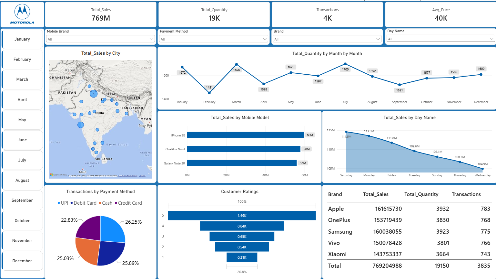

# Motorola Mobile Sales Dashboard | Power BI

An interactive Power BI dashboard for analyzing mobile phone sales performance across brands, models, cities, payment methods, customer ratings, and months.



## Table of contents

- [Project overview](#project-overview)
- [Dashboard preview](#dashboard-preview)
- [Key performance indicators](#key-performance-indicators)
- [Dashboard features](#dashboard-features)
- [Key observations](#key-observations)
- [Dataset](#dataset)
- [Repository structure](#repository-structure)
- [Tools and technologies](#tools-and-technologies)
- [How to use](#how-to-use)
- [Possible future enhancements](#possible-future-enhancements)

## Project overview

The Motorola Mobile Sales Dashboard presents a consolidated view of mobile phone sales transactions. It is designed to help explore overall sales, units sold, transaction volume, average price, and differences across brands, mobile models, cities, payment methods, customer ratings, and days of the week.

The report uses interactive filters so users can narrow the analysis by month, mobile brand, payment method, brand, and day name.

## Dashboard preview

The dashboard contains the following sections:

1. KPI cards for total sales, total quantity, transactions, and average price.
2. Month selector buttons along the left side.
3. Slicers for mobile brand, payment method, brand, and day name.
4. City-level sales map.
5. Monthly quantity trend.
6. Sales by mobile model.
7. Sales by day name.
8. Transactions by payment method.
9. Customer rating distribution.
10. Brand-level summary table.

## Key performance indicators

The values below are the totals displayed in the supplied dashboard screenshot. They reflect the current unfiltered report view.

| KPI | Dashboard value |
|---|---:|
| Total Sales | 769M (exact table total: 769,204,988) |
| Total Quantity | 19K (exact table total: 19,150) |
| Transactions | 4K (exact table total: 3,835) |
| Average Price | 40K |

## Dashboard features

### 1. Sales by city

A map visual plots sales geographically across the cities represented in the dataset. Bubble size communicates relative sales volume by city.

### 2. Quantity sold by month

A line chart shows total quantity for each month:

| Month | Quantity |
|---|---:|
| January | 1,672 |
| February | 1,451 |
| March | 1,696 |
| April | 1,528 |
| May | 1,625 |
| June | 1,597 |
| July | 1,700 |
| August | 1,592 |
| September | 1,521 |
| October | 1,577 |
| November | 1,582 |
| December | 1,609 |

### 3. Sales by mobile model

The bar chart highlights the three models shown in the screenshot:

| Mobile model | Displayed sales |
|---|---:|
| iPhone SE | 60M |
| OnePlus Nord | 58M |
| Galaxy Note 20 | 56M |

### 4. Sales by day name

The area chart compares sales across weekdays. In the displayed order, Saturday has the highest shown value (114.6M) and Wednesday the lowest (104.9M).

| Day | Displayed sales |
|---|---:|
| Saturday | 114.6M |
| Monday | 113.5M |
| Friday | 111.8M |
| Tuesday | 109.6M |
| Sunday | 108.1M |
| Thursday | 106.7M |
| Wednesday | 104.9M |

### 5. Transactions by payment method

The pie chart shows the distribution of transactions:

| Payment method | Share |
|---|---:|
| UPI | 26.25% |
| Debit Card | 25.89% |
| Cash | 25.03% |
| Credit Card | 22.83% |

### 6. Customer ratings

A funnel visual displays the distribution of customer ratings from 1 to 5. The screenshot shows the following rounded counts:

| Rating | Displayed count |
|---|---:|
| 5 | 1.49K |
| 4 | 0.84K |
| 3 | 0.65K |
| 2 | 0.54K |
| 1 | 0.31K |

### 7. Brand performance

The brand summary table provides total sales, quantity, and transactions by brand:

| Brand | Total sales | Total quantity | Transactions |
|---|---:|---:|---:|
| Apple | 161,615,730 | 3,932 | 783 |
| OnePlus | 153,719,439 | 3,830 | 768 |
| Samsung | 160,038,055 | 3,923 | 775 |
| Vivo | 150,078,428 | 3,801 | 766 |
| Xiaomi | 143,753,337 | 3,664 | 743 |
| **Total** | **769,204,988** | **19,150** | **3,835** |

## Key observations

Based on the values visible in the unfiltered dashboard screenshot:

- Apple has the highest brand sales total in the brand table (161.62M).
- Apple also has the highest total quantity (3,932) and transaction count (783) among the listed brands.
- July has the highest monthly quantity shown (1,700), while February has the lowest (1,451).
- UPI is the largest payment-method share shown (26.25%).
- iPhone SE is the highest-selling model among the three models displayed in the model chart (60M).
- Saturday has the highest displayed sales by day name (114.6M).

These are observations from the supplied dashboard view, not causal explanations. Values may change when slicers are applied.

## Dataset

The source workbook is `data/mobile-sales-data.xlsx`.

The main worksheet (`Sheet1`) contains 3,835 transaction records and 14 columns:

- Transaction ID
- Day
- Month
- Year
- Day Name
- Brand
- Units Sold
- Price Per Unit
- Customer Name
- Customer Age
- City
- Payment Method
- Customer Ratings
- Mobile Model

The workbook also contains a second worksheet (`Sheet2`) with a single-column city list.

> **Privacy note:** The source dataset contains customer names and ages. Before making this repository public, remove or anonymize personally identifying customer information and confirm that you have permission to publish the dataset. Do not upload private customer data.

## Repository structure

```text
Motorola_sales_dashboard/
├── Screenshot/
│   └── dashboard-overview.png
├── dashboard/
│   └── Motorola_Dashboard.pbix
├── data/
│   └── mobile-sales-data.xlsx
├── docs/
│   ├── dashboard-overview.md
│   └── data-dictionary.md
└── README.md
```

If your existing folder names differ, keep the image path in this README synchronized with the actual screenshot folder and filename.

## Tools and technologies

- Microsoft Power BI Desktop — dashboard development and visualization
- Microsoft Excel — source dataset

## How to use

1. Clone or download this repository.
2. Open `dashboard/Motorola_Dashboard.pbix` in Power BI Desktop.
3. If Power BI prompts for the source file, update the source path to `data/mobile-sales-data.xlsx`.
4. Refresh the dataset if required.
5. Use the month selector and slicers to interact with the report.

## Possible future enhancements

- Add a dedicated date table and document time-intelligence measures.
- Add drill-through pages for brand, model, and city analysis.
- Add year-over-year and month-over-month comparisons where the dataset supports them.
- Document DAX measures and Power Query transformation steps.
- Publish a sanitized dashboard preview and sample dataset.
- Add a Power BI Service deployment and refresh guide.

## Author

**Ghanshyam Seervi**

- GitHub: [Ghan539](https://github.com/Ghan539)
- Main Power BI repository: [Power_bi](https://github.com/Ghan539/Power_bi)
